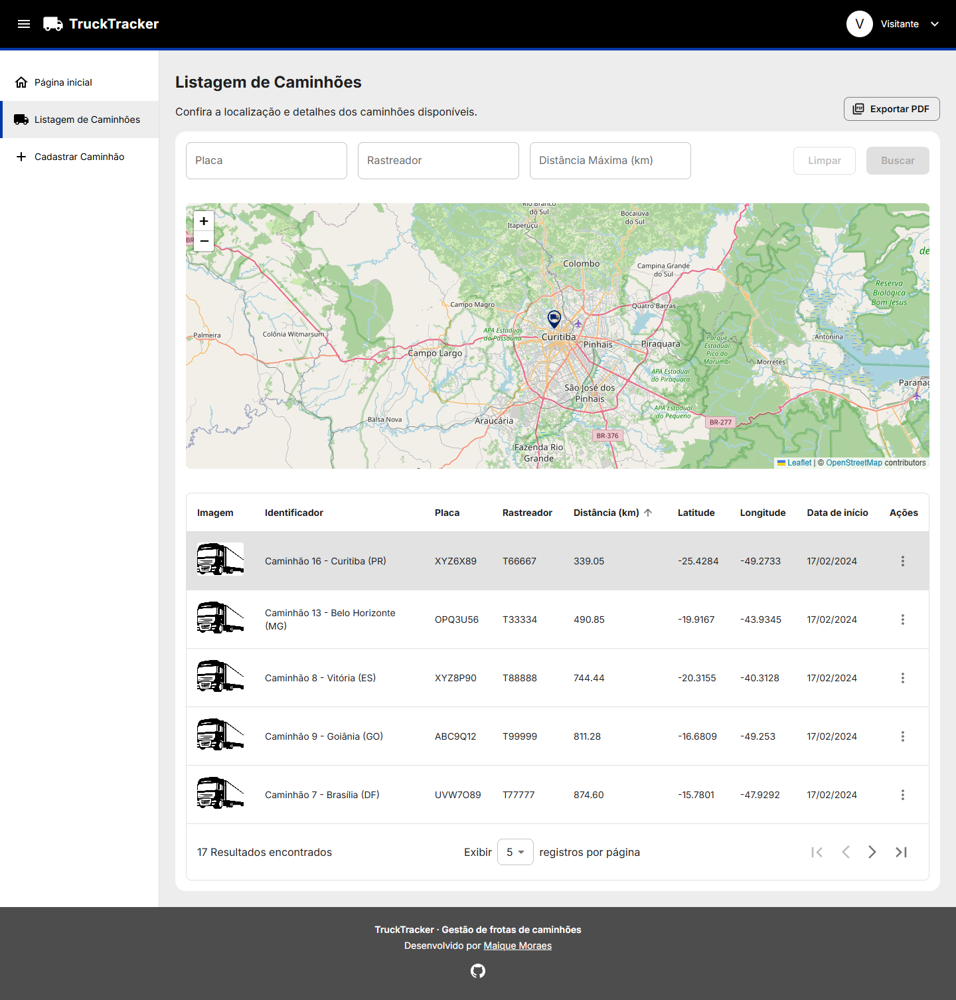
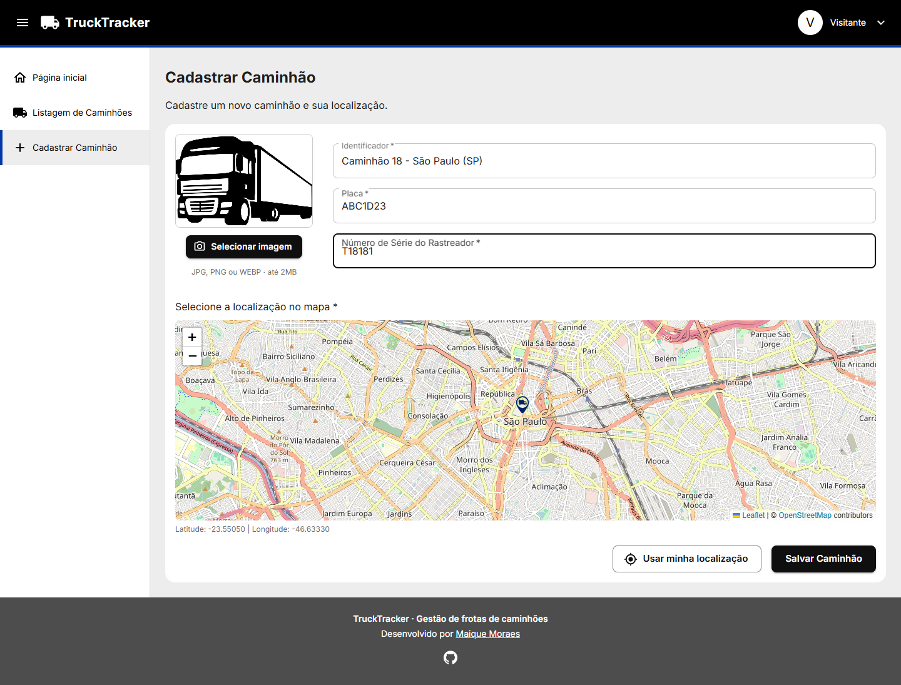
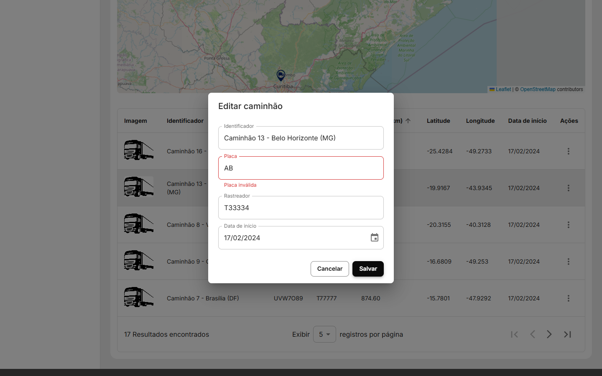
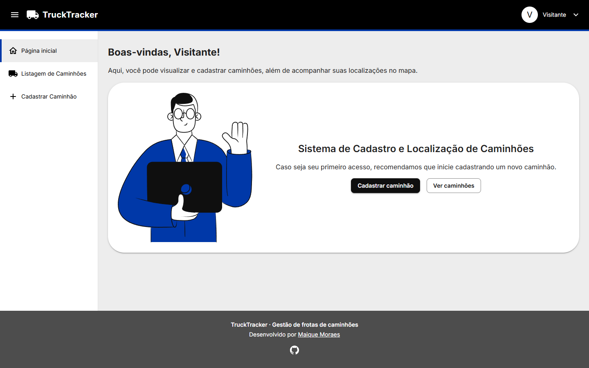
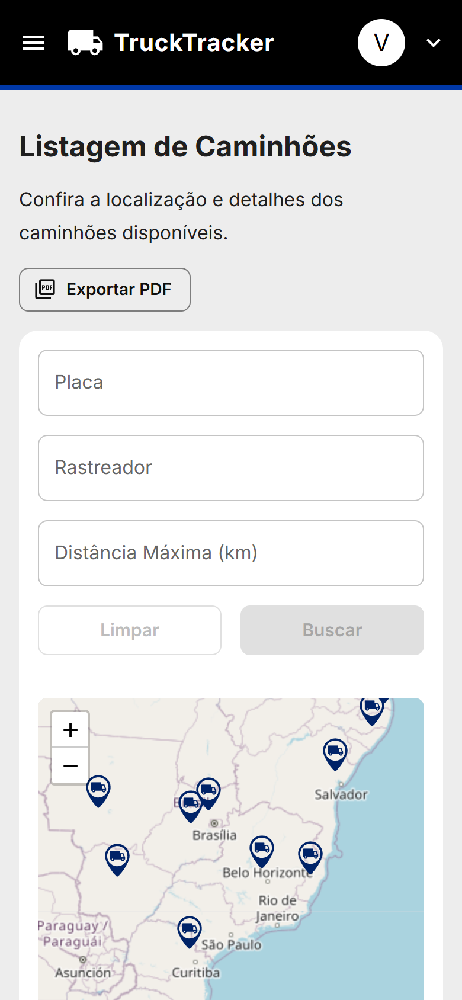
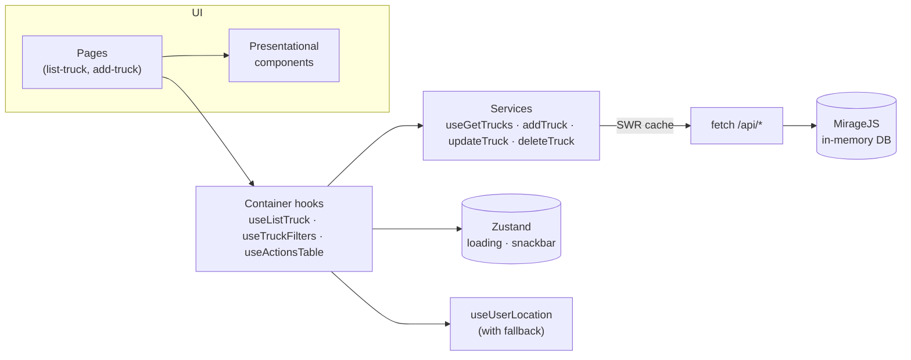

<div align="center">

# 🚚 TruckTracker

**Fleet management web app: register trucks and track them on an interactive map, sorted by distance from you.**

[](https://github.com/cybermaique/trucktracker/actions/workflows/ci.yml)
[](https://github.com/cybermaique/trucktracker/actions/workflows/deploy.yml)
[](./LICENSE)


[**Live demo**](https://cybermaique.github.io/trucktracker/) · [Features](#-features) · [Architecture](#-architecture) · [Getting started](#-getting-started) · [Leia em português 🇧🇷](./README.pt-BR.md)



</div>

## 📌 About

TruckTracker started as the take-home challenge for a **Frontend Developer position at [Inlog](https://github.com/weareinlog/Desafio-Inlog---Vaga-Frontend-Developer)**, which I passed. The brief asked for two pages: a truck list sorted by proximity to the user, with every truck pinned on a map, and a form to register new trucks. It also asked for automated tests covering the list, the form and the fake API.

I went beyond the brief with filters, edit/delete, image upload, PDF export, and a migration from CRA to Vite. I later revisited the project to bring it up to production standards: a CI pipeline, a live demo, accessibility and responsive design, stricter typing, broader tests and zero known vulnerabilities.

> The app has no real backend. A [MirageJS](https://miragejs.com/) server intercepts requests in the browser and keeps the data in memory, so the deployed demo is fully interactive. Data resets when you reload the page.

## ✨ Features

|                                |                                                                                                                                                                                                              |
| ------------------------------ | ------------------------------------------------------------------------------------------------------------------------------------------------------------------------------------------------------------ |
| 🗺️ **Interactive map**         | Every truck is pinned on a Leaflet/OpenStreetMap map. Clicking a row flies to that truck; clicking a pin shows its details.                                                                                  |
| 📍 **Sorted by proximity**     | Distances come from the user's position (Haversine formula). If geolocation is denied, the app falls back to a default location instead of rendering an empty page.                                          |
| 🔎 **Filters & sorting**       | Filter by license plate, tracker serial number or maximum distance, and toggle ascending/descending distance.                                                                                                |
| ➕ **Registration form**       | React Hook Form + Zod validation, live license plate formatting (both the old `ABC-1234` and Mercosul `ABC1D23` formats), location picked on the map or from the device, and an optional photo (up to 2 MB). |
| ✏️ **Edit & delete**           | Edit with the same validation rules, and delete behind a confirmation dialog. The list is revalidated through SWR.                                                                                           |
| 📄 **PDF report**              | Exports the filtered list to PDF. jsPDF is loaded on demand, so it isn't part of the initial bundle.                                                                                                         |
| 📱 **Responsive & accessible** | Mobile drawer navigation, keyboard-operable table rows, labelled controls, a skip link and semantic landmarks.                                                                                               |

<details>
<summary><strong>📸 More screenshots</strong></summary>

| Registration                                           | Edit with validation                           |
| ------------------------------------------------------ | ---------------------------------------------- |
|  |  |

| Home                               | Mobile                                           | Mobile navigation                                |
| ---------------------------------- | ------------------------------------------------ | ------------------------------------------------ |
|  |  |  |

</details>

## 🛠 Tech stack

| Concern      | Choice                                                                        |
| ------------ | ----------------------------------------------------------------------------- |
| UI           | React 19, TypeScript (strict), MUI 6, Emotion                                 |
| Build        | Vite 6, code splitting with lazy routes and vendor chunks                     |
| Server state | SWR (caching, revalidation, mutations)                                        |
| Client state | Zustand (global loading and notifications)                                    |
| Forms        | React Hook Form + Zod                                                         |
| Maps         | Leaflet + React Leaflet (OpenStreetMap tiles)                                 |
| Fake API     | MirageJS                                                                      |
| Testing      | Vitest, React Testing Library, user-event, jest-dom                           |
| Quality      | ESLint (typescript-eslint, react-hooks), Prettier, GitHub Actions, Dependabot |

## 🏗 Architecture

The pages follow the **container/presentational** pattern. Data fetching, derived state and side effects live in hooks (`src/containers`), and components only render what they receive. This keeps the UI easy to test and the business rules easy to find.



```text
src/
├── api/          # SWR fetcher
├── components/   # Presentational components (one folder per component, tests alongside)
├── constants/    # API routes, map, table and app constants
├── containers/   # Page-level hooks holding state and business rules
├── hooks/        # Reusable hooks (geolocation, pagination)
├── interfaces/   # Domain types
├── mirage/       # Fake REST API
├── pages/        # Route components (lazy loaded)
├── services/     # API calls
├── stores/       # Zustand stores
├── tests/        # Test setup and helpers
├── utils/        # Pure functions (distance, formatting, PDF report)
└── validation/   # Zod schemas
```

### Technical decisions

- **SWR for server state, Zustand for UI state.** The challenge suggested Redux, and an early version stored the API response in a Redux slice. That duplicated what SWR already caches, so I removed it: SWR owns server data, and a tiny Zustand store holds the global snackbar and loading overlay.
- **Derived state with `useMemo`.** Sorting and filtering are computed from the API data, the filters and the user's location. They are not copied into component state.
- **Resilient geolocation.** Distances need a reference point. If the user denies permission (or the API is missing), the app warns them and uses São Paulo as the reference, so the list still renders.
- **Mirage in every environment.** It lets the static GitHub Pages build behave like a real app. Test runs use Mirage's `test` environment: no seed data and no artificial latency.
- **Performance.** Routes are lazy loaded, vendors are split into cache-friendly chunks, and jsPDF (~400 kB) is only downloaded when a report is requested.

## 🚀 Getting started

**Requirements:** Node.js 20+ (22 LTS recommended, see `.nvmrc`) and [pnpm](https://pnpm.io/) 10.

```bash
git clone https://github.com/cybermaique/trucktracker.git
cd trucktracker
pnpm install
pnpm dev
```

The app runs at `http://localhost:5173`. Allow location access to see real distances.

### Scripts

| Command                             | Description                                              |
| ----------------------------------- | -------------------------------------------------------- |
| `pnpm dev`                          | Start the dev server                                     |
| `pnpm build`                        | Type-check and build for production                      |
| `pnpm preview`                      | Serve the production build locally                       |
| `pnpm test`                         | Run the test suite once                                  |
| `pnpm test:watch`                   | Run tests in watch mode                                  |
| `pnpm test:coverage`                | Run tests with a coverage report (`coverage/index.html`) |
| `pnpm lint` / `pnpm lint:fix`       | Lint the codebase                                        |
| `pnpm format` / `pnpm format:check` | Format with Prettier                                     |
| `pnpm typecheck`                    | Run the TypeScript compiler                              |
| `pnpm validate`                     | Run everything CI runs                                   |

## 🧪 Testing & quality

- **Unit and integration tests** with Vitest and React Testing Library. Page tests render the real components against the Mirage API, with geolocation stubbed, and assert on what the user sees: sorting, filtering, editing, deleting, exporting and form validation.
- **Coverage thresholds** (90% statements and lines, 80% branches) are enforced. The current suite covers about 97% of lines.
- **CI** on every push and pull request: lint → format check → type check → tests with coverage → production build.
- **Continuous deployment** to GitHub Pages on every push to `main`.
- **Dependabot** keeps npm packages and GitHub Actions up to date. `pnpm audit` reports no known vulnerabilities.

## 🗺 Roadmap

- [ ] Real backend and authentication (OIDC/Keycloak)
- [ ] End-to-end tests with Playwright
- [ ] Marker clustering for large fleets
- [ ] Persist filters and pagination in the URL
- [ ] Internationalization (pt-BR / en)

## 🙏 Acknowledgments

Thanks to **Danielle Capello de Oliveira** and **Alexandre Borges** for their contributions.

## 📄 License

[MIT](./LICENSE) © [Maique Moraes](https://github.com/cybermaique)
