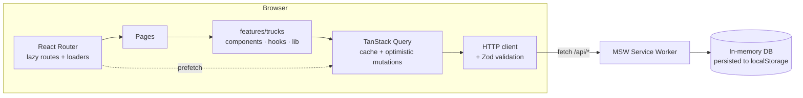

<div align="center">

# 🚚 TruckTracker

**Fleet management web app: register trucks and follow them on an interactive vector map, sorted by distance from you.**

[](https://github.com/cybermaique/trucktracker/actions/workflows/ci.yml)
[](https://github.com/cybermaique/trucktracker/actions/workflows/deploy.yml)
[](./LICENSE)


[**▶ Live demo**](https://cybermaique.github.io/trucktracker/) · [Features](#-features) · [Tech decisions](#-tech-stack-and-decisions) · [Architecture](#-architecture) · [Quality](#-quality) · [Leia em português 🇧🇷](./README.pt-BR.md)

<picture>
  <source media="(prefers-color-scheme: dark)" srcset="docs/screenshots/overview-dark.png" />
  
</picture>

</div>

## 📌 About

TruckTracker began as the take-home challenge for a **Frontend Developer position at [Inlog](https://github.com/weareinlog/Desafio-Inlog---Vaga-Frontend-Developer)**, which I passed. The brief asked for a truck list sorted by proximity to the user with every truck pinned on a map, a registration form, and tests for the list, the form and a fake API.

I later rebuilt it as **v2**, a portfolio case that answers one question: _how would I build this today, with no constraints?_ Every library was re-evaluated against the current ecosystem (October 2026), the UI was redesigned from scratch, and the project got the delivery pipeline I would expect from a production codebase.

> **No backend required.** A [Mock Service Worker](https://mswjs.io/) intercepts `/api/*` at the network level, so the deployed demo is fully interactive. Data lives in your browser's `localStorage`; use _Restaurar dados da demo_ in the sidebar to reset it.

## ✨ Features

|                             |                                                                                                                                                                                                                                                                                                                                                                                                     |
| --------------------------- | --------------------------------------------------------------------------------------------------------------------------------------------------------------------------------------------------------------------------------------------------------------------------------------------------------------------------------------------------------------------------------------------------- |
| 🗺️ **Vector map**           | MapLibre GL with OpenFreeMap tiles: smooth zoom, **marker clustering**, light/dark map styles, a "frame the fleet" control and a popup for the selected truck.                                                                                                                                                                                                                                      |
| 📍 **Straight line & road** | The list is ranked by **straight-line** distance from you (Haversine): instant, offline and the natural meaning of a search radius. For the selected truck, the map draws the **actual road route** with driving distance and **travel time** (OSRM), falling back to a straight line if routing is unavailable. If location access is denied, distances start from São Paulo, and the app says so. |
| 🔎 **Shareable filters**    | Search by name, plate or tracker (ignoring case, accents and punctuation), plus a distance radius. Filters and the selected truck live in the **URL**, so any view can be bookmarked or shared.                                                                                                                                                                                                     |
| 📊 **Overview dashboard**   | KPIs, the five nearest trucks and a distance distribution chart built with plain HTML/CSS.                                                                                                                                                                                                                                                                                                          |
| 🚚 **Truck page**           | `/caminhoes/:id`: vehicle sheet, road route on the map, "open route in Google Maps", copy coordinates, edit/delete, and a proper 404 for unknown ids.                                                                                                                                                                                                                                               |
| ⌨️ **Command palette**      | `Ctrl/⌘ + K` finds any truck by name, plate or tracker, jumps to pages or switches the theme, all from the keyboard.                                                                                                                                                                                                                                                                                |
| ➕ **Create & edit**        | One form for both flows (React Hook Form + Zod): live plate formatting (old `ABC-1234` and Mercosul `ABC1D23` formats), a map picker with a draggable marker, and photo upload **resized in the browser** before saving. API conflicts (duplicated plate, `409`) show up on the right field.                                                                                                        |
| ⚡ **Optimistic UI**        | Deleting and editing update the screen instantly and **roll back** if the request fails.                                                                                                                                                                                                                                                                                                            |
| 📄 **Export**               | PDF report (jsPDF, loaded on demand) and an Excel-friendly CSV of the current filtered list.                                                                                                                                                                                                                                                                                                        |
| 🌗 **Themes & responsive**  | Light, dark or system theme with no flash on load; collapsible sidebar that becomes a drawer on mobile.                                                                                                                                                                                                                                                                                             |
| ♿ **Accessible**           | Keyboard-operable table, labelled controls, landmarks, a skip link, and **automated WCAG 2.1 AA audits** in both themes.                                                                                                                                                                                                                                                                            |

<details>
<summary><strong>📸 Screenshots</strong></summary>

| Fleet list: search radius + selected truck                                              | Dark theme                                                     |
| --------------------------------------------------------------------------------------- | -------------------------------------------------------------- |
|  |  |

| Truck page with road route                                                            | Command palette                                                           |
| ------------------------------------------------------------------------------------- | ------------------------------------------------------------------------- |
|  |  |

| New truck                                                         | Validation                                                 |
| ----------------------------------------------------------------- | ---------------------------------------------------------- |
|  |  |

| Edit in a side sheet                                | Mobile                                                 | Mobile navigation                                  |
| --------------------------------------------------- | ------------------------------------------------------ | -------------------------------------------------- |
|  |  |  |

</details>

## 🛠 Tech stack and decisions

| Concern      | Choice                                                          | Why (and what I compared it with)                                                                                                                                                                                         |
| ------------ | --------------------------------------------------------------- | ------------------------------------------------------------------------------------------------------------------------------------------------------------------------------------------------------------------------- |
| UI runtime   | **React 19** + **React Compiler**                               | Automatic memoization: no hand-written `useMemo`/`useCallback`. Its ESLint rules catch impure renders and state set inside effects.                                                                                       |
| Language     | **TypeScript 6** (strict, `noUncheckedIndexedAccess`)           | Strict types and checked indexed access, with type-aware ESLint rules alongside the React Compiler checks.                                                                                                                |
| Build        | **Vite 8** (Rolldown)                                           | Route-level code splitting, long-cached vendor chunks, and heavy libraries (jsPDF, ~400 kB) loaded only when needed.                                                                                                      |
| Maps         | **MapLibre GL** + `@vis.gl/react-maplibre` + **OpenFreeMap**    | WebGL vector tiles, native clustering and data-driven styling. The demo uses OpenFreeMap without an API key, keeping setup simple for visitors and contributors.                                                          |
| Server state | **TanStack Query**                                              | Query-key factories, optimistic mutations with rollback, and prefetching from route loaders. It replaced SWR and a Redux slice that only duplicated the cache.                                                            |
| Routing      | **React Router 8** (data mode)                                  | Lazy routes, loaders that start fetching in parallel with the chunk download, breadcrumbs from route `handle`s.                                                                                                           |
| UI kit       | **Tailwind CSS 4** + **shadcn/ui** (Radix)                      | Accessible primitives with code we own and theme through CSS variables. It replaced MUI 6, whose runtime CSS-in-JS and default look did not fit a custom design.                                                          |
| Forms        | **React Hook Form** + **Zod 4**                                 | A single schema validates the form, and a `transform` narrows its output to the domain type.                                                                                                                              |
| API contract | **Zod at the boundary**                                         | Responses are parsed and mapped from the challenge's snake_case DTO to a camelCase domain model.                                                                                                                          |
| Mock API     | **MSW 3**                                                       | The same handlers serve the browser demo (Service Worker), unit tests (Node) and E2E tests. It replaced **MirageJS** and keeps browser and test API behavior in one place.                                                |
| Routing      | **OSRM** (FOSSGIS instance) + polyline6                         | Keyless, CORS-enabled road routing for the selected truck, decoded with a small, tested polyline decoder. A production setup would self-host OSRM/Valhalla or use a provider with truck profiles (weight, height, tolls). |
| Testing      | **Vitest 5**, **Testing Library**, **Playwright**, **axe-core** | Behavior-driven unit/integration tests plus real-browser E2E and accessibility audits.                                                                                                                                    |
| Tooling      | ESLint 10, Prettier, knip, husky + lint-staged, Dependabot      | Static analysis, dead-code detection and dependency hygiene, all enforced in CI.                                                                                                                                          |

## 🏗 Architecture

Code is organized **by feature**: everything about trucks (API, hooks, components, domain logic, schemas) lives together. Pages only compose features.



```text
src/
├── app/            # Composition root: providers, routes (lazy + loaders), query client
├── components/     # App shell (sidebar, header), theme, shared states; ui/ = shadcn primitives
├── features/
│   ├── location/   # Geolocation as a cached query, with fallback and status badge
│   └── trucks/
│       ├── api/        # HTTP calls, query keys/options, mutations
│       ├── components/ # Map, location picker, table, form, sheets, dialogs, charts
│       ├── hooks/      # Fleet data with distances, URL-backed filters
│       ├── lib/        # Pure domain logic: distance, filters, geo shapes, stats, export
│       └── schemas.ts  # Zod: API DTO + form schema, DTO ↔ domain mapping
├── lib/            # HTTP client, formatters, site constants, utilities
├── mocks/          # MSW handlers, seed data and repository (same in demo and tests)
├── pages/          # Route components
└── test/           # Test setup, render helpers, factories, map test double
```

**Patterns worth a look**

- **URL as state**: [`use-truck-filters.ts`](src/features/trucks/hooks/use-truck-filters.ts). Local state is the source of truth, so the UI reacts in the same frame. The URL mirrors it (search debounced), and each write serializes the whole state so quick successive changes never overwrite each other.
- **Render-as-you-fetch**: [`routes.tsx`](src/app/routes.tsx) loaders prefetch data while the page chunk downloads.
- **Optimistic mutations with rollback**: [`mutations.ts`](src/features/trucks/api/mutations.ts).
- **Geolocation as a query**: [`use-user-location.ts`](src/features/location/use-user-location.ts) never rejects; it resolves to the device position or a labelled fallback, and the result is cached across pages.
- **Library interop with the compiler**: [`trucks-table.tsx`](src/features/trucks/components/trucks-table.tsx) opts out with `"use no memo"` because TanStack Table mutates a stable instance internally. The comment explains why.

## ✅ Quality

| Check                                                             | What it guarantees                                                                                                                                                                           |
| ----------------------------------------------------------------- | -------------------------------------------------------------------------------------------------------------------------------------------------------------------------------------------- |
| **140 unit & integration tests** (Vitest + Testing Library + MSW) | Pages render the real routes against the real handlers: sorting, URL filters, optimistic delete with rollback, edit conflicts, validation, exports, error/empty states.                      |
| **56 E2E tests** (Playwright, desktop + mobile)                   | Production build in a real browser: Service Worker API, WebGL map, road routes (stubbed at the browser context), truck page, command palette, create/delete flows, persistence after reload. |
| **Accessibility audits** (axe-core)                               | No WCAG 2.1 A/AA violations on every page, in light **and** dark themes, plus no horizontal overflow on any viewport.                                                                        |
| **Coverage thresholds**                                           | 90% statements/lines, 85% branches, measured on React Compiler output (currently ~92% statements, 85% branches, 98% lines).                                                                  |
| **Static analysis**                                               | Strict TypeScript, ESLint with React Compiler and TanStack Query rules, knip for unused code.                                                                                                |
| **CI/CD**                                                         | Every push and PR runs all of the above. `main` deploys to GitHub Pages. Dependabot groups monthly updates.                                                                                  |

## 🚀 Getting started

**Requirements:** Node.js 24 LTS (`nvm use` reads `.nvmrc`) and [pnpm](https://pnpm.io/) 10.

```bash
git clone https://github.com/cybermaique/trucktracker.git
cd trucktracker
pnpm install
pnpm dev
```

Open `http://localhost:5173` and allow location access to see real distances.

| Command                                                      | Description                                                                                                                 |
| ------------------------------------------------------------ | --------------------------------------------------------------------------------------------------------------------------- |
| `pnpm dev`                                                   | Dev server with HMR and React Query Devtools                                                                                |
| `pnpm build` / `pnpm preview`                                | Type-check and build / serve the production build                                                                           |
| `pnpm test` / `pnpm test:watch`                              | Unit and integration tests                                                                                                  |
| `pnpm test:coverage`                                         | Tests with coverage report (`coverage/index.html`)                                                                          |
| `pnpm test:e2e`                                              | Playwright suite (run `pnpm exec playwright install chromium` once, or set `PW_CHANNEL=chrome` to use an installed browser) |
| `pnpm lint` / `pnpm format` / `pnpm typecheck` / `pnpm knip` | Static analysis                                                                                                             |
| `pnpm validate`                                              | Everything the CI quality job runs                                                                                          |

## 🌐 Demo and deployment

The [live demo](https://cybermaique.github.io/trucktracker/) runs without an account, API keys or environment variables. The interface is in Brazilian Portuguese.

- Truck records, edits and photos stay in this browser's `localStorage`; they are not shared between devices or visitors. Clearing site data or choosing **Restaurar dados da demo** resets the fleet.
- Positions are demo data or manually entered coordinates. The app does not receive live GPS telemetry.
- Map tiles and road routes need an internet connection. Road routing uses a **car profile**, without truck height, weight or cargo restrictions; it falls back to a straight line when unavailable.

The [deployment workflow](.github/workflows/deploy.yml) publishes pushes to `main` to GitHub Pages. It builds with `BASE_PATH=/<repository-name>/` and copies `index.html` to `404.html` so direct links can load the SPA. The router and Service Worker use the configured base path.

For another static host, publish `dist/`, set `BASE_PATH` to its deployment path (or keep `/` for the root), and configure unknown routes to serve `index.html`. A direct link on GitHub Pages can return HTTP 404 while still loading the app through its fallback page.

## 🧭 Project history

- **v1 (Feb 2025)** – Challenge delivery: React 19, MUI, Leaflet, SWR, MirageJS, Redux, Vitest. Approved.
- **v1.1** – Review pass: fixed broken build and lint, restored the lost PDF export, removed 53 vulnerable dependencies, and added CI and a live demo.
- **v2 (Oct 2026)** – Full rebuild described above. See the [pull request](https://github.com/cybermaique/trucktracker/pulls?q=is%3Apr+v2) for the reasoning behind each change.

## 🗺 Roadmap

- [ ] Real backend (REST or tRPC) with authentication
- [ ] Live positions over WebSocket/SSE (MSW can already mock both)
- [ ] Route history and geofencing alerts per truck
- [ ] Internationalization (pt-BR / en)

## 🙏 Acknowledgments

Thanks to **Danielle Capello de Oliveira** and **Alexandre Borges** for their contributions during the original challenge.

## 👤 Author

**Maique Moraes** · [LinkedIn](https://www.linkedin.com/in/maique-moraes) · [GitHub](https://github.com/cybermaique)

## 📄 License

[MIT](./LICENSE)
