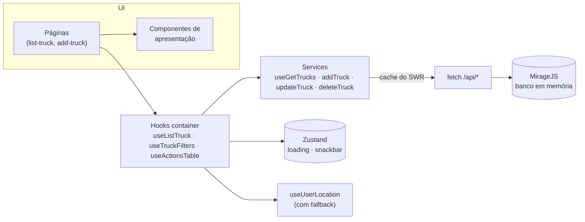

<div align="center">

# 🚚 TruckTracker

**Aplicação web de gestão de frotas: cadastre caminhões e acompanhe-os em um mapa interativo, ordenados pela distância até você.**

[](https://github.com/cybermaique/trucktracker/actions/workflows/ci.yml)
[](https://github.com/cybermaique/trucktracker/actions/workflows/deploy.yml)
[](./LICENSE)


[**Demo online**](https://cybermaique.github.io/trucktracker/) · [Funcionalidades](#-funcionalidades) · [Arquitetura](#-arquitetura) · [Como rodar](#-como-rodar) · [Read in English 🇺🇸](./README.md)


</div>

## 📌 Sobre

O TruckTracker nasceu como desafio técnico para uma **vaga de Frontend Developer na [Inlog](https://github.com/weareinlog/Desafio-Inlog---Vaga-Frontend-Developer)**, no qual fui aprovado. O enunciado pedia duas páginas: uma listagem de caminhões ordenada pela proximidade do usuário, com cada caminhão marcado em um mapa, e um formulário de cadastro. Também pedia testes automatizados cobrindo a listagem, o formulário e a API fake.

Fui além do enunciado com filtros, edição/exclusão, upload de imagem, exportação em PDF e a migração de CRA para Vite. Depois revisitei o projeto para levá-lo a um padrão de produção: pipeline de CI, demo online, acessibilidade e responsividade, tipagem mais rígida, testes mais abrangentes e nenhuma vulnerabilidade conhecida.

> A aplicação não tem backend real. Um servidor [MirageJS](https://miragejs.com/) intercepta as requisições no navegador e mantém os dados em memória, por isso a demo publicada é totalmente interativa. Os dados voltam ao estado inicial quando você recarrega a página.

## ✨ Funcionalidades

|                                  |                                                                                                                                                                                                               |
| -------------------------------- | ------------------------------------------------------------------------------------------------------------------------------------------------------------------------------------------------------------- |
| 🗺️ **Mapa interativo**           | Cada caminhão aparece em um mapa Leaflet/OpenStreetMap. Clicar em uma linha leva o mapa até o caminhão; clicar no pin mostra os detalhes.                                                                     |
| 📍 **Ordenação por proximidade** | As distâncias são calculadas a partir da posição do usuário (fórmula de Haversine). Se a geolocalização for negada, a aplicação usa uma localização padrão em vez de exibir uma página vazia.                 |
| 🔎 **Filtros e ordenação**       | Filtro por placa, número do rastreador ou distância máxima, e alternância entre ordem crescente e decrescente de distância.                                                                                   |
| ➕ **Formulário de cadastro**    | Validação com React Hook Form + Zod, formatação da placa durante a digitação (padrões antigo `ABC-1234` e Mercosul `ABC1D23`), localização escolhida no mapa ou pelo dispositivo, e foto opcional (até 2 MB). |
| ✏️ **Edição e exclusão**         | Edição com as mesmas regras de validação, e exclusão com diálogo de confirmação. A lista é revalidada via SWR.                                                                                                |
| 📄 **Relatório em PDF**          | Exporta a lista filtrada em PDF. O jsPDF é carregado sob demanda, então não entra no bundle inicial.                                                                                                          |
| 📱 **Responsivo e acessível**    | Navegação em drawer no mobile, linhas da tabela operáveis pelo teclado, controles com rótulos, link de "pular para o conteúdo" e landmarks semânticos.                                                        |

<details>
<summary><strong>📸 Mais screenshots</strong></summary>

| Cadastro                                                     | Edição com validação                                   |
| ------------------------------------------------------------ | ------------------------------------------------------ |
|  |  |

| Página inicial                               | Mobile                                                  | Navegação mobile                                    |
| -------------------------------------------- | ------------------------------------------------------- | --------------------------------------------------- |
|  |  |  |

</details>

## 🛠 Tecnologias

| Responsabilidade   | Escolha                                                                       |
| ------------------ | ----------------------------------------------------------------------------- |
| Interface          | React 19, TypeScript (strict), MUI 6, Emotion                                 |
| Build              | Vite 6, code splitting com rotas lazy e chunks de vendors                     |
| Estado do servidor | SWR (cache, revalidação, mutações)                                            |
| Estado do cliente  | Zustand (loading e notificações globais)                                      |
| Formulários        | React Hook Form + Zod                                                         |
| Mapas              | Leaflet + React Leaflet (tiles do OpenStreetMap)                              |
| API fake           | MirageJS                                                                      |
| Testes             | Vitest, React Testing Library, user-event, jest-dom                           |
| Qualidade          | ESLint (typescript-eslint, react-hooks), Prettier, GitHub Actions, Dependabot |

## 🏗 Arquitetura

As páginas seguem o padrão **container/presentational**. Busca de dados, estado derivado e efeitos colaterais ficam em hooks (`src/containers`), e os componentes apenas renderizam o que recebem. Isso mantém a interface fácil de testar e as regras de negócio fáceis de encontrar.



```text
src/
├── api/          # Fetcher do SWR
├── components/   # Componentes de apresentação (uma pasta por componente, com testes ao lado)
├── constants/    # Rotas da API, mapa, tabela e constantes da aplicação
├── containers/   # Hooks de página com estado e regras de negócio
├── hooks/        # Hooks reutilizáveis (geolocalização, paginação)
├── interfaces/   # Tipos de domínio
├── mirage/       # API REST fake
├── pages/        # Componentes de rota (carregados sob demanda)
├── services/     # Chamadas à API
├── stores/       # Stores Zustand
├── tests/        # Setup e helpers de teste
├── utils/        # Funções puras (distância, formatação, relatório PDF)
└── validation/   # Schemas Zod
```

### Decisões técnicas

- **SWR para estado do servidor, Zustand para estado de interface.** O desafio sugeria Redux, e uma versão inicial guardava a resposta da API em um slice Redux. Isso duplicava o que o SWR já mantém em cache, então removi: o SWR cuida dos dados do servidor, e uma store Zustand mínima guarda o snackbar e o loading globais.
- **Estado derivado com `useMemo`.** A ordenação e os filtros são calculados a partir dos dados da API, dos filtros e da localização do usuário. Eles não são copiados para o estado do componente.
- **Geolocalização resiliente.** O cálculo de distância precisa de um ponto de referência. Se o usuário negar a permissão (ou a API não existir), a aplicação avisa e usa São Paulo como referência, e a listagem continua aparecendo.
- **Mirage em todos os ambientes.** Isso permite que o build estático no GitHub Pages se comporte como uma aplicação real. Os testes usam o ambiente `test` da Mirage: sem dados iniciais e sem latência artificial.
- **Performance.** As rotas são carregadas sob demanda, os vendors ficam em chunks separados que o navegador mantém em cache, e o jsPDF (~400 kB) só é baixado quando um relatório é solicitado.

## 🚀 Como rodar

**Requisitos:** Node.js 20+ (recomendado 22 LTS, veja `.nvmrc`) e [pnpm](https://pnpm.io/) 10.

```bash
git clone https://github.com/cybermaique/trucktracker.git
cd trucktracker
pnpm install
pnpm dev
```

A aplicação sobe em `http://localhost:5173`. Permita o acesso à localização para ver as distâncias reais.

### Scripts

| Comando                             | Descrição                                                         |
| ----------------------------------- | ----------------------------------------------------------------- |
| `pnpm dev`                          | Inicia o servidor de desenvolvimento                              |
| `pnpm build`                        | Checa os tipos e gera o build de produção                         |
| `pnpm preview`                      | Serve o build de produção localmente                              |
| `pnpm test`                         | Roda a suíte de testes uma vez                                    |
| `pnpm test:watch`                   | Roda os testes em modo watch                                      |
| `pnpm test:coverage`                | Roda os testes com relatório de cobertura (`coverage/index.html`) |
| `pnpm lint` / `pnpm lint:fix`       | Analisa o código com o ESLint                                     |
| `pnpm format` / `pnpm format:check` | Formata com o Prettier                                            |
| `pnpm typecheck`                    | Roda o compilador TypeScript                                      |
| `pnpm validate`                     | Roda tudo o que o CI roda                                         |

## 🧪 Testes e qualidade

- **Testes unitários e de integração** com Vitest e React Testing Library. Os testes de página renderizam os componentes reais contra a API da Mirage, com a geolocalização simulada, e verificam o que o usuário vê: ordenação, filtros, edição, exclusão, exportação e validação do formulário.
- **Limites mínimos de cobertura** (90% de statements e linhas, 80% de branches) são exigidos. A suíte atual cobre cerca de 97% das linhas.
- **CI** a cada push e pull request: lint → checagem de formatação → checagem de tipos → testes com cobertura → build de produção.
- **Deploy contínuo** no GitHub Pages a cada push na `main`.
- **Dependabot** mantém os pacotes npm e as GitHub Actions atualizados. O `pnpm audit` não reporta nenhuma vulnerabilidade conhecida.

## 🗺 Próximos passos

- [ ] Backend real e autenticação (OIDC/Keycloak)
- [ ] Testes end-to-end com Playwright
- [ ] Agrupamento de marcadores para frotas grandes
- [ ] Persistir filtros e paginação na URL
- [ ] Internacionalização (pt-BR / en)

## 🙏 Agradecimentos

Agradeço a **Danielle Capello de Oliveira** e **Alexandre Borges** pela contribuição de ambos.

## 📄 Licença

[MIT](./LICENSE) © [Maique Moraes](https://github.com/cybermaique)
