<div align="center">

# 🚚 TruckTracker

**Aplicação web de gestão de frotas: cadastre caminhões e acompanhe-os em um mapa vetorial interativo, ordenados pela distância até você.**

[](https://github.com/cybermaique/trucktracker/actions/workflows/ci.yml)
[](https://github.com/cybermaique/trucktracker/actions/workflows/deploy.yml)
[](./LICENSE)


[**▶ Demo online**](https://cybermaique.github.io/trucktracker/) · [Funcionalidades](#-funcionalidades) · [Decisões técnicas](#-tecnologias-e-decisões) · [Arquitetura](#-arquitetura) · [Qualidade](#-qualidade) · [Read in English 🇺🇸](./README.md)

<picture>
  <source media="(prefers-color-scheme: dark)" srcset="docs/screenshots/overview-dark.png" />
  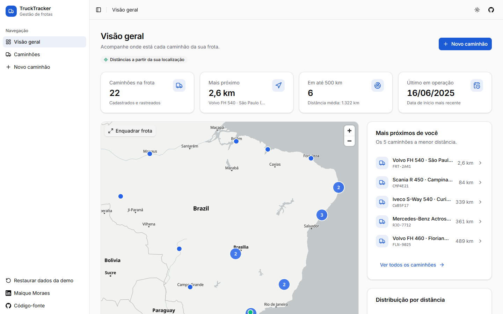
</picture>

</div>

## 📌 Sobre

O TruckTracker nasceu como desafio técnico para uma **vaga de Frontend Developer na [Inlog](https://github.com/weareinlog/Desafio-Inlog---Vaga-Frontend-Developer)**, no qual fui aprovado. O enunciado pedia uma listagem de caminhões ordenada pela proximidade do usuário com cada caminhão marcado em um mapa, um formulário de cadastro e testes para a listagem, o formulário e uma API fake.

Depois, reconstruí o projeto como **v2**: um case de portfólio que responde a uma pergunta, _como eu construiria isso hoje, sem restrições?_ Cada biblioteca foi reavaliada frente ao ecossistema atual (outubro de 2026), a interface foi redesenhada do zero e o projeto ganhou o pipeline de entrega que eu esperaria de um código em produção.

> **Sem backend.** Um [Mock Service Worker](https://mswjs.io/) intercepta `/api/*` no nível de rede, então a demo publicada é totalmente interativa. Os dados ficam no `localStorage` do seu navegador; use _Restaurar dados da demo_ na barra lateral para voltar ao estado inicial.

## ✨ Funcionalidades

|                                |                                                                                                                                                                                                                                                                                                                                                                                                                                         |
| ------------------------------ | --------------------------------------------------------------------------------------------------------------------------------------------------------------------------------------------------------------------------------------------------------------------------------------------------------------------------------------------------------------------------------------------------------------------------------------- |
| 🗺️ **Mapa vetorial**           | MapLibre GL com tiles da OpenFreeMap: zoom suave, **agrupamento de marcadores**, estilos claro/escuro, botão para enquadrar a frota e popup do caminhão selecionado.                                                                                                                                                                                                                                                                    |
| 📍 **Linha reta e estrada**    | A lista é ordenada pela distância **em linha reta** até você (Haversine): instantânea, sem depender de rede e o sentido natural de um raio de busca. Para o caminhão selecionado, o mapa desenha a **rota real por estrada**, com distância e **tempo de viagem** (OSRM), e volta para a linha reta se o roteamento estiver indisponível. Se o acesso à localização for negado, as distâncias partem de São Paulo, e a aplicação avisa. |
| 🔎 **Filtros compartilháveis** | Busca por nome, placa ou rastreador (ignorando maiúsculas, acentos e pontuação), além de raio de distância. Filtros e caminhão selecionado ficam na **URL**: qualquer visão pode ser salva ou compartilhada.                                                                                                                                                                                                                            |
| 📊 **Visão geral**             | Indicadores, os cinco caminhões mais próximos e um gráfico de distribuição por distância feito em HTML/CSS puro.                                                                                                                                                                                                                                                                                                                        |
| 🚚 **Página do caminhão**      | `/caminhoes/:id`: ficha do veículo, rota por estrada no mapa, "abrir rota no Google Maps", copiar coordenadas, editar/excluir e 404 para IDs inexistentes.                                                                                                                                                                                                                                                                              |
| ⌨️ **Paleta de comandos**      | `Ctrl/⌘ + K` encontra qualquer caminhão por nome, placa ou rastreador, navega entre páginas e troca o tema, tudo pelo teclado.                                                                                                                                                                                                                                                                                                          |
| ➕ **Cadastro e edição**       | Um único formulário para os dois fluxos (React Hook Form + Zod): formatação da placa durante a digitação (padrões antigo `ABC-1234` e Mercosul `ABC1D23`), seletor no mapa com marcador arrastável e foto **redimensionada no navegador** antes de salvar. Conflitos da API (placa duplicada, `409`) aparecem no campo certo.                                                                                                           |
| ⚡ **Interface otimista**      | Excluir e editar atualizam a tela na hora e **desfazem a mudança** se a requisição falhar.                                                                                                                                                                                                                                                                                                                                              |
| 📄 **Exportação**              | Relatório em PDF (jsPDF carregado sob demanda) e CSV compatível com Excel da lista filtrada.                                                                                                                                                                                                                                                                                                                                            |
| 🌗 **Temas e responsividade**  | Tema claro, escuro ou do sistema, sem piscar ao carregar; barra lateral recolhível que vira gaveta no mobile.                                                                                                                                                                                                                                                                                                                           |
| ♿ **Acessível**               | Tabela operável pelo teclado, controles com rótulos, landmarks, link de "pular para o conteúdo" e **auditorias automatizadas WCAG 2.1 AA** nos dois temas.                                                                                                                                                                                                                                                                              |

<details>
<summary><strong>📸 Screenshots</strong></summary>

| Lista da frota: raio de busca + caminhão selecionado                             | Tema escuro                                               |
| -------------------------------------------------------------------------------- | --------------------------------------------------------- |
| 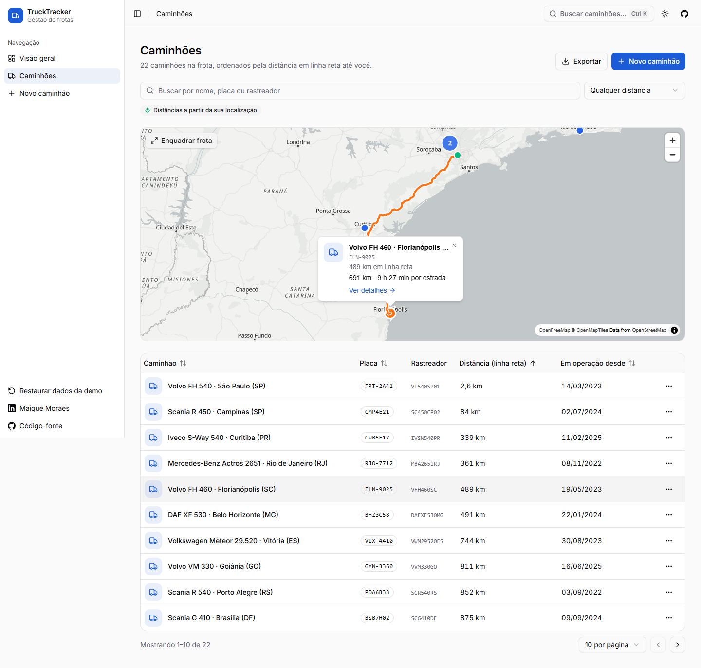 | 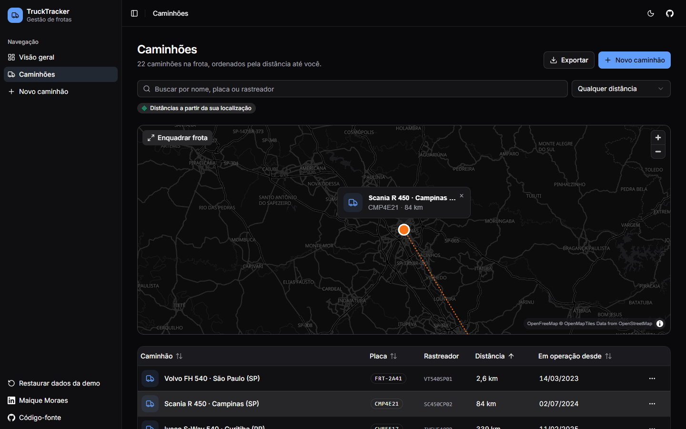 |

| Página do caminhão com rota por estrada                                              | Paleta de comandos                                                             |
| ------------------------------------------------------------------------------------ | ------------------------------------------------------------------------------ |
| 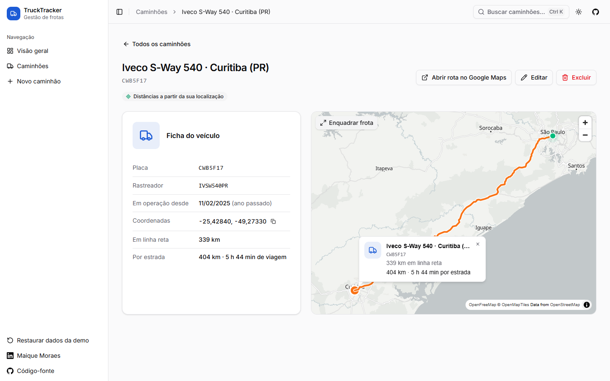 | 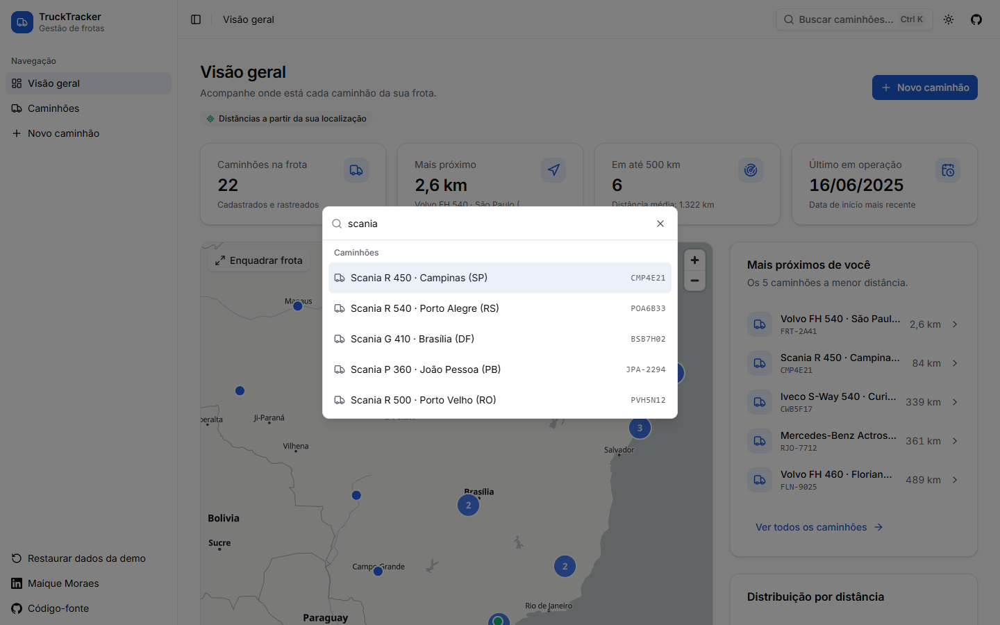 |

| Novo caminhão                                                     | Validação                                              |
| ----------------------------------------------------------------- | ------------------------------------------------------ |
| 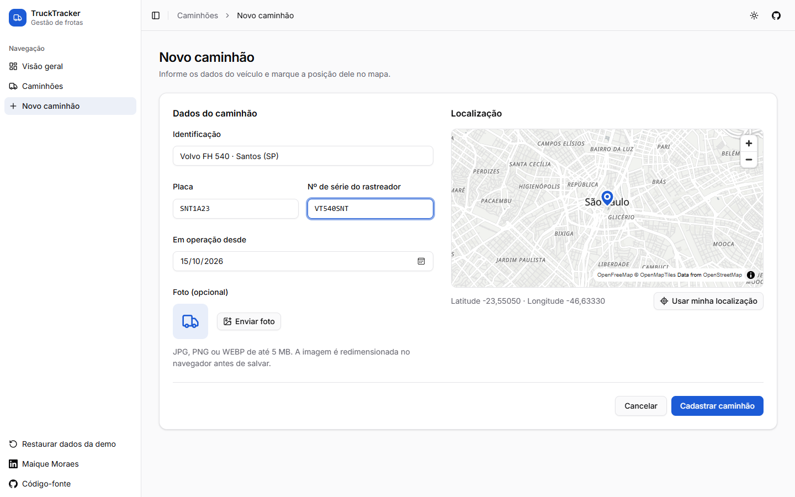 | 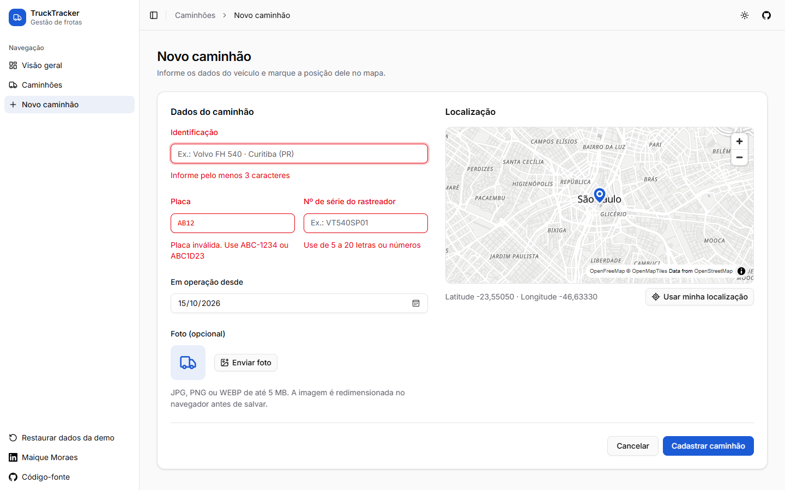 |

| Edição em painel lateral                            | Mobile                                                 | Navegação mobile                                         |
| --------------------------------------------------- | ------------------------------------------------------ | -------------------------------------------------------- |
| 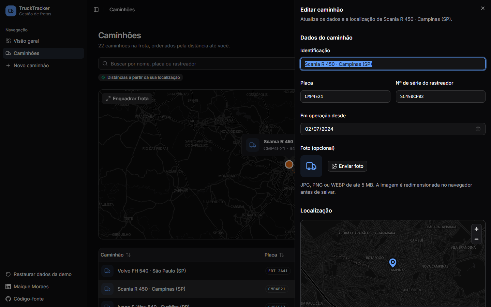 | 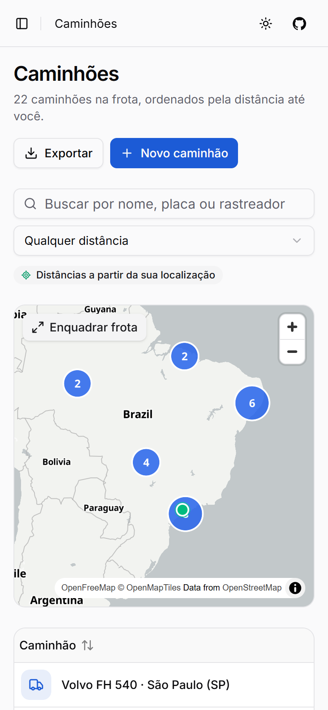 | 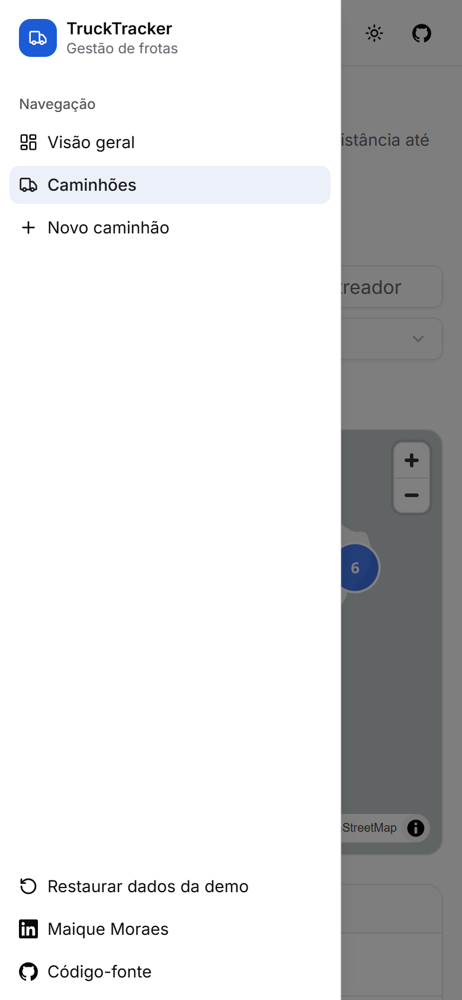 |

</details>

## 🛠 Tecnologias e decisões

| Responsabilidade   | Escolha                                                         | Por quê (e com o que comparei)                                                                                                                                                                                                                                        |
| ------------------ | --------------------------------------------------------------- | --------------------------------------------------------------------------------------------------------------------------------------------------------------------------------------------------------------------------------------------------------------------- |
| Interface          | **React 19** + **React Compiler**                               | Memoização automática, sem `useMemo`/`useCallback` escritos à mão. As regras de ESLint do compilador pegam renders impuros e `setState` dentro de efeitos.                                                                                                            |
| Linguagem          | **TypeScript 6** (strict, `noUncheckedIndexedAccess`)           | Tipos estritos e acesso indexado verificado, com regras ESLint que usam tipos junto às verificações do React Compiler.                                                                                                                                                |
| Build              | **Vite 8** (Rolldown)                                           | Code splitting por rota, chunks de vendors com cache longo e bibliotecas pesadas (jsPDF, ~400 kB) baixadas só quando necessárias.                                                                                                                                     |
| Mapas              | **MapLibre GL** + `@vis.gl/react-maplibre` + **OpenFreeMap**    | Tiles vetoriais em WebGL, agrupamento nativo e estilos orientados a dados. A demo usa OpenFreeMap sem chave de API, simplificando o uso por visitantes e contribuidores.                                                                                              |
| Estado do servidor | **TanStack Query**                                              | Fábrica de query keys, mutações otimistas com rollback e pré-busca nos loaders das rotas. Substituiu o SWR e um slice Redux que só duplicava o cache.                                                                                                                 |
| Rotas              | **React Router 8** (data mode)                                  | Rotas lazy, loaders que começam a buscar dados em paralelo ao download do chunk, breadcrumb a partir do `handle` de cada rota.                                                                                                                                        |
| UI                 | **Tailwind CSS 4** + **shadcn/ui** (Radix)                      | Primitivos acessíveis, com código que é nosso e tema por variáveis CSS. Substituiu o MUI 6, cujo CSS-in-JS em runtime e visual padrão não combinavam com um design próprio.                                                                                           |
| Formulários        | **React Hook Form** + **Zod 4**                                 | Um único schema valida o formulário, e um `transform` estreita a saída para o tipo de domínio.                                                                                                                                                                        |
| Contrato da API    | **Zod na fronteira**                                            | As respostas são validadas e convertidas do DTO snake_case do desafio para um modelo de domínio em camelCase.                                                                                                                                                         |
| API fake           | **MSW 3**                                                       | Os mesmos handlers servem a demo no navegador (Service Worker), os testes unitários (Node) e os testes E2E. Substituiu o **MirageJS** e mantém o comportamento da API do navegador e dos testes no mesmo lugar.                                                       |
| Roteamento         | **OSRM** (instância do FOSSGIS) + polyline6                     | Rotas por estrada sem chave de API e com CORS para o caminhão selecionado, decodificadas por um decodificador de polyline pequeno e testado. Em produção, o caminho seria hospedar OSRM/Valhalla ou usar um provedor com perfil de caminhão (peso, altura, pedágios). |
| Testes             | **Vitest 5**, **Testing Library**, **Playwright**, **axe-core** | Testes de comportamento (unitários/integração) mais E2E e auditoria de acessibilidade em navegador real.                                                                                                                                                              |
| Ferramentas        | ESLint 10, Prettier, knip, husky + lint-staged, Dependabot      | Análise estática, detecção de código morto e higiene de dependências, tudo exigido no CI.                                                                                                                                                                             |

## 🏗 Arquitetura

O código é organizado **por feature**: tudo sobre caminhões (API, hooks, componentes, lógica de domínio, schemas) fica junto. As páginas apenas compõem features.

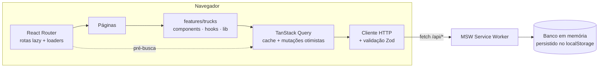

```text
src/
├── app/            # Raiz de composição: providers, rotas (lazy + loaders), query client
├── components/     # Shell (sidebar, header), tema, estados compartilhados; ui/ = primitivos shadcn
├── features/
│   ├── location/   # Geolocalização como query em cache, com fallback e indicador
│   └── trucks/
│       ├── api/        # Chamadas HTTP, query keys/options, mutações
│       ├── components/ # Mapa, seletor de local, tabela, formulário, painéis, diálogos, gráficos
│       ├── hooks/      # Frota com distâncias, filtros sincronizados com a URL
│       ├── lib/        # Lógica de domínio pura: distância, filtros, geometria, estatísticas, exportação
│       └── schemas.ts  # Zod: DTO da API + schema do formulário, mapeamento DTO ↔ domínio
├── lib/            # Cliente HTTP, formatadores, constantes do site, utilitários
├── mocks/          # Handlers MSW, dados iniciais e repositório (iguais na demo e nos testes)
├── pages/          # Componentes de rota
└── test/           # Setup de testes, helpers de render, factories, dublê do mapa
```

**Padrões que valem uma olhada**

- **URL como estado**: [`use-truck-filters.ts`](src/features/trucks/hooks/use-truck-filters.ts). O estado local é a fonte da verdade, então a interface reage no mesmo frame. A URL o espelha (a busca com debounce), e cada escrita serializa o estado completo para que mudanças rápidas não se sobrescrevam.
- **Render-as-you-fetch**: os loaders em [`routes.tsx`](src/app/routes.tsx) pré-buscam os dados enquanto o chunk da página é baixado.
- **Mutações otimistas com rollback**: [`mutations.ts`](src/features/trucks/api/mutations.ts).
- **Geolocalização como query**: [`use-user-location.ts`](src/features/location/use-user-location.ts) nunca rejeita. Resolve para a posição do dispositivo ou para um fallback identificado, e o resultado fica em cache entre as páginas.
- **Interoperabilidade com o compilador**: [`trucks-table.tsx`](src/features/trucks/components/trucks-table.tsx) usa `"use no memo"` porque o TanStack Table muta internamente uma instância estável. O comentário explica o motivo.

## ✅ Qualidade

| Verificação                                                               | O que garante                                                                                                                                                                                                                         |
| ------------------------------------------------------------------------- | ------------------------------------------------------------------------------------------------------------------------------------------------------------------------------------------------------------------------------------- |
| **140 testes unitários e de integração** (Vitest + Testing Library + MSW) | As páginas renderizam as rotas reais contra os handlers reais: ordenação, filtros na URL, exclusão otimista com rollback, conflitos na edição, validação, exportação, estados de erro e vazio.                                        |
| **56 testes E2E** (Playwright, desktop + mobile)                          | Build de produção em navegador real: API via Service Worker, mapa WebGL, rotas por estrada (simuladas no contexto do navegador), página do caminhão, paleta de comandos, fluxos de cadastro e exclusão, persistência após recarregar. |
| **Auditorias de acessibilidade** (axe-core)                               | Nenhuma violação WCAG 2.1 A/AA em todas as páginas, nos temas claro **e** escuro, além de nenhum scroll horizontal em qualquer viewport.                                                                                              |
| **Limites de cobertura**                                                  | 90% de statements/linhas e 85% de branches, medidos sobre o código gerado pelo React Compiler (hoje ~92% de statements, 85% de branches e 98% de linhas).                                                                             |
| **Análise estática**                                                      | TypeScript strict, ESLint com as regras do React Compiler e do TanStack Query, knip para código não usado.                                                                                                                            |
| **CI/CD**                                                                 | Cada push e PR roda tudo acima. A `main` publica no GitHub Pages. O Dependabot agrupa atualizações mensais.                                                                                                                           |

## 🚀 Como rodar

**Requisitos:** Node.js 24 LTS (`nvm use` lê o `.nvmrc`) e [pnpm](https://pnpm.io/) 10.

```bash
git clone https://github.com/cybermaique/trucktracker.git
cd trucktracker
pnpm install
pnpm dev
```

Abra `http://localhost:5173` e permita o acesso à localização para ver as distâncias reais.

| Comando                                                      | Descrição                                                                                                                      |
| ------------------------------------------------------------ | ------------------------------------------------------------------------------------------------------------------------------ |
| `pnpm dev`                                                   | Servidor de desenvolvimento com HMR e React Query Devtools                                                                     |
| `pnpm build` / `pnpm preview`                                | Checa os tipos e gera o build / serve o build de produção                                                                      |
| `pnpm test` / `pnpm test:watch`                              | Testes unitários e de integração                                                                                               |
| `pnpm test:coverage`                                         | Testes com relatório de cobertura (`coverage/index.html`)                                                                      |
| `pnpm test:e2e`                                              | Suíte Playwright (rode `pnpm exec playwright install chromium` uma vez, ou use `PW_CHANNEL=chrome` com um navegador instalado) |
| `pnpm lint` / `pnpm format` / `pnpm typecheck` / `pnpm knip` | Análise estática                                                                                                               |
| `pnpm validate`                                              | Tudo o que o job de qualidade do CI roda                                                                                       |

## 🌐 Demo e publicação

A [demo online](https://cybermaique.github.io/trucktracker/) funciona sem conta, chaves de API ou variáveis de ambiente. A interface está em português brasileiro.

- Cadastros, edições e fotos ficam no `localStorage` deste navegador; não são compartilhados entre dispositivos ou visitantes. Limpar os dados do site ou escolher **Restaurar dados da demo** restaura a frota inicial.
- As posições são dados de exemplo ou coordenadas preenchidas manualmente. O app não recebe telemetria GPS em tempo real.
- Os mapas e as rotas por estrada precisam de internet. O roteamento usa um **perfil de carro**, sem restrições de altura, peso ou carga de caminhões; se falhar, o mapa usa uma linha reta.

O [workflow de publicação](.github/workflows/deploy.yml) publica os pushes na `main` no GitHub Pages. O build usa `BASE_PATH=/<nome-do-repositorio>/` e copia `index.html` para `404.html` para permitir que links diretos carreguem a SPA. O roteador e o Service Worker usam o caminho base configurado.

Em outra hospedagem estática, publique `dist/`, ajuste `BASE_PATH` ao caminho de publicação (ou mantenha `/` para a raiz) e configure rotas desconhecidas para servir `index.html`. No GitHub Pages, um link direto pode responder HTTP 404 e ainda carregar o app pela página de fallback.

## 🧭 Histórico

- **v1 (fev/2025)**: entrega do desafio com React 19, MUI, Leaflet, SWR, MirageJS, Redux e Vitest. Aprovado.
- **v1.1**: revisão que corrigiu build e lint quebrados, restaurou a exportação em PDF perdida, eliminou 53 vulnerabilidades e adicionou CI e demo online.
- **v2 (out/2026)**: reconstrução completa descrita acima. O [pull request](https://github.com/cybermaique/trucktracker/pulls?q=is%3Apr+v2) traz o raciocínio de cada mudança.

## 🗺 Próximos passos

- [ ] Backend real (REST ou tRPC) com autenticação
- [ ] Posições ao vivo via WebSocket/SSE (o MSW já simula os dois)
- [ ] Histórico de rotas e alertas de cerca geográfica por caminhão
- [ ] Internacionalização (pt-BR / en)

## 🙏 Agradecimentos

Agradeço a **Danielle Capello de Oliveira** e **Alexandre Borges** pela contribuição durante o desafio original.

## 👤 Autor

**Maique Moraes** · [LinkedIn](https://www.linkedin.com/in/maique-moraes) · [GitHub](https://github.com/cybermaique)

## 📄 Licença

[MIT](./LICENSE)
